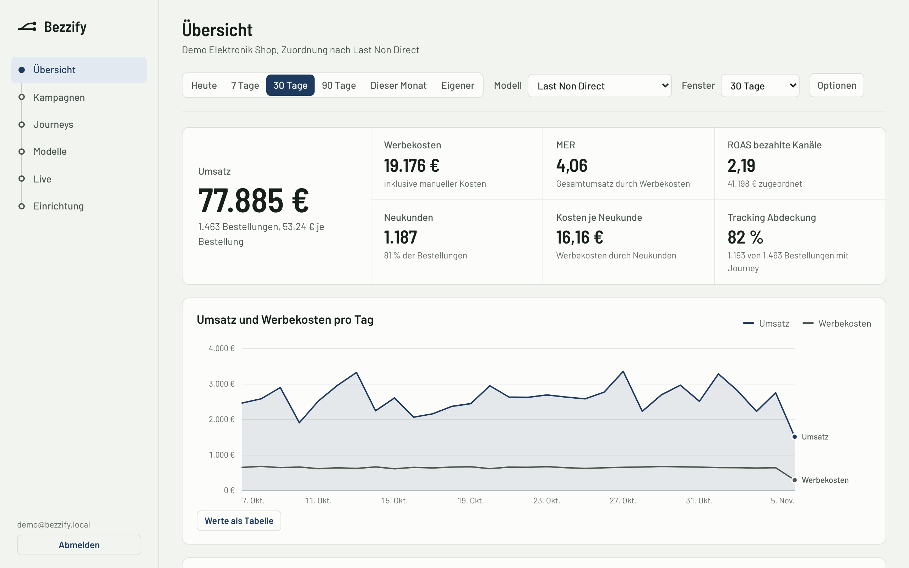
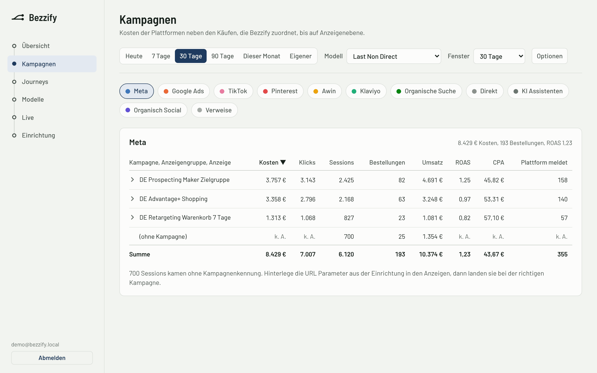
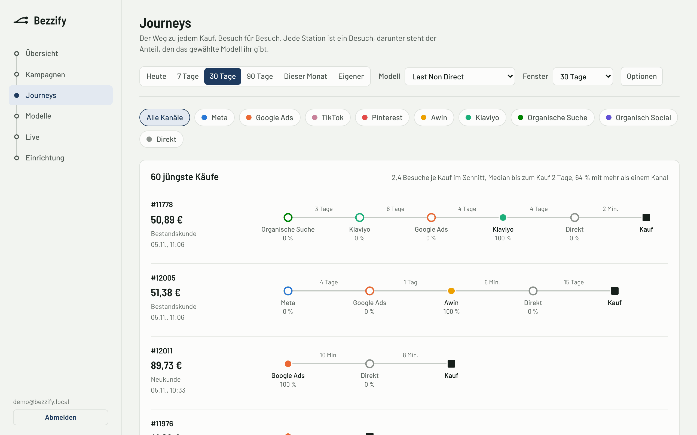
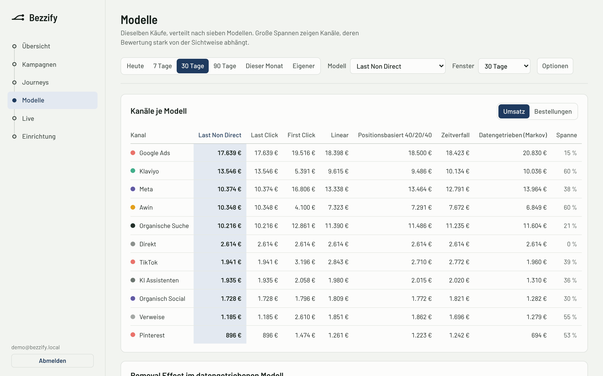
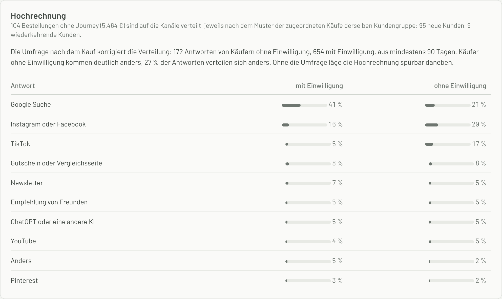

# Bezzify

Self hosted marketing attribution for online shops. Bezzify records visits with a first party script, matches them to the orders your shop reports and splits every order across the channels, campaigns and ads that led to it. Each order is counted exactly once.

<picture>
  <source media="(prefers-color-scheme: dark)" srcset="docs/screenshots/overview-dark.png">
  
</picture>

Ad platforms all count the same purchase for themselves. With Meta, Google, TikTok, Pinterest and an affiliate network running at the same time, the sum of what they report is often far above your real revenue. Bezzify shows both numbers next to each other, so budget decisions start from orders that actually happened.

It runs on your own server, keeps the data in your own PostgreSQL database and was built around German and EU consent rules. The dashboard and the plugin settings are in German for now. The screenshots show the demo shop that `npm run demo` creates.

<table>
  <tr>
    <td width="50%" valign="top">
      
      <br><sub>Campaigns down to the single ad, with what the platform reports next to what Bezzify attributes.</sub>
    </td>
    <td width="50%" valign="top">
      
      <br><sub>Every purchase with its visits, the time between them and the share each visit gets.</sub>
    </td>
  </tr>
  <tr>
    <td width="50%" valign="top">
      
      <br><sub>The same purchases under seven models. A wide range means a channel's value depends on the point of view.</sub>
    </td>
    <td width="50%" valign="top">
      
      <br><sub>Orders without consent, extrapolated per customer group and checked against the post purchase question.</sub>
    </td>
  </tr>
</table>

## What it covers

| Area | Details |
|---|---|
| Tracking | First party script (`/t.js`, about 2.5 KB gzipped) and a Shopify custom pixel. Reads click IDs from Meta, Google, TikTok, Pinterest, Microsoft, Awin and Klaviyo, UTM tags and its own `bzf_*` parameters down to the single ad |
| Consent | Two levels. Statistics consent allows measurement and attribution, marketing consent also allows sending purchases back to ad platforms. Works with your own banner, Cookiebot, Shopify customer privacy and the Shopware consent manager |
| Without consent | Orders still carry the landing page from the shop as a fallback. Orders without a journey can be extrapolated across channels, separately for new and returning customers and corrected with the answers to the post purchase question |
| Post purchase question | Optional question on the thank you page, "How did you hear about us?", for Shopify, Shopware, WooCommerce and custom sites. The answers show whether buyers without consent come through other channels than the rest |
| Matching | Deterministic only: visitor ID, checkout, hashed email and customer number. That also links visits across devices |
| Models | First click, last click, last non direct, linear, position based (40/20/40), time decay and a data driven model based on Markov chains with removal effect |
| Settings | Window from one day to unlimited, attribute by order date or touch date, ignore direct visits, gross or net revenue, subtract refunds |
| Costs | Daily spend per ad from Meta, Google Ads (including Performance Max), TikTok and Pinterest, archived and deleted ads included. Awin commissions per publisher. Manual costs for things like a Klaviyo plan or influencers |
| Platform comparison | Purchases and revenue the platforms report, next to what Bezzify attributes to them |
| Sending purchases back | Meta Conversions API, Google Ads click conversions, TikTok Events API, Pinterest Conversions API, Awin Conversion API with deduplication by last paid click |
| Shops | Shopify (pixel and webhooks), Shopware 6 (plugin), WooCommerce (plugin), custom sites (script and server API) |
| Dashboard | Overview, campaigns down to the ad, customer journeys, model comparison, live view, setup with every snippet and a diagnostics page |
| Tenants | Workspaces with shops and users. Every row carries a `site_id`, so the data model is ready for running it as a service |

## Getting started

You need Node.js 20 or newer. Without `DATABASE_URL`, Bezzify uses an embedded Postgres (PGlite) in `./data/pglite`, so there is nothing else to install.

```bash
npm install
npm run demo        # demo shop with 45 days of sample data
npm run build       # tracker, dashboard and server
npm start           # http://localhost:8787
```

Log in with `demo@bezzify.local` and the password `bezzify-demo`.

For development, server and dashboard run separately and reload on change:

```bash
npm run dev             # server on port 8787
npm run dev:dashboard   # dashboard on port 5173, proxies API calls to the server
```

To create your own shop:

```bash
npm run cli -- setup --workspace "My Company" --site "My Shop" --platform shopify \
  --domain myshop.de --domain myshop.myshopify.com --email you@myshop.de --password "a long password"
```

The output shows the public site key and, only this once, the secret key. `npm run cli -- help` lists the other commands.

## Running it in production

1. Copy `.env.example` to `.env` and set `PUBLIC_URL`, `APP_SECRET` (at least 32 characters, `openssl rand -hex 32` works) and `POSTGRES_PASSWORD`.
2. `docker compose up -d --build` starts Bezzify with PostgreSQL 16. In Coolify, add the repository as a Docker Compose resource and point the domain at port 8787. The compose file only binds the port to `127.0.0.1`, because Bezzify is meant to sit behind a reverse proxy.
3. Create the shop with `docker compose exec bezzify node dist/cli.js setup ...` and the options shown above.

Run Bezzify on a subdomain of the shop, for example `t.myshop.de`, ideally on a server in the EU. On a subdomain you can set the cookie domain under Einrichtung. The server then sets the visitor cookie itself, which Safari keeps much longer than a cookie written by JavaScript.

`TRUST_PROXY` is the number of your own proxies in front of Bezzify: `1` for Coolify, Traefik or Caddy, `2` with Cloudflare in front of those. Bezzify reads `X-Forwarded-For` from the right by that many entries, because anything further left can be sent by the client. Without the setting, all visitors behind a proxy share one IP and hit the rate limit early. Logins are limited per IP and per email address, and logging out ends every session of that user, not just the one in the current browser.

Background jobs run inside the server: purchases are sent back every 30 seconds, costs are imported every hour for the last three days (30 days on the first run), and old data is cleaned up every six hours. With several instances, a Postgres advisory lock makes sure each job runs once.

A single instance with PostgreSQL took about 800 events per second in a load test. A typical shop sends less than one per second on average.

## Connecting a shop

The setup page in the dashboard shows every snippet with your keys already filled in.

**Shopify.** Add `integrations/shopify/custom-pixel.js` as a custom pixel under Settings, Customer events. It covers all pages and the checkout. Set the customer privacy permission to required with the analytics category. Purchases are only sent to ad platforms when the visitor also allowed marketing. If you treat attribution as marketing, select both. Then add webhooks for order creation, order update, order cancellation and refund creation pointing to `https://<server>/webhooks/shopify/<site_id>`, and enter the webhook signing secret in the dashboard. List both your own domain and the myshopify domain as shop domains.

**Shopware 6.** Copy `integrations/shopware/BezzifyTracking` to `custom/plugins`, then run `bin/console plugin:refresh`, `bin/console plugin:install --activate BezzifyTracking` and `bin/console cache:clear`. Enter endpoint, site key and secret key in the plugin configuration. The plugin adds its own group to the Shopware cookie consent with two entries, measurement and reporting to ad platforms. Orders, cancellations and refunds go through the Shopware message queue and are retried up to six times over almost 15 hours when Bezzify can't be reached, so the queue worker has to run. The plugin works with Shopware 6.5 to 6.7.

**WooCommerce.** Zip the folder `integrations/woocommerce/bezzify`, upload it as a plugin (WooCommerce 7.2 or newer) and fill in the values under Settings, Bezzify. Orders, cancellations and refunds are sent through the WooCommerce Action Scheduler, which keeps the checkout fast and retries the same way as the Shopware plugin. If Bezzify stays unreachable, the order gets a note. For Borlabs, Real Cookie Banner or Complianz, add `bezzify('consent','granted');` as the opt in code for marketing and `bezzify('consent','analytics');` for statistics. HPOS is supported.

**Custom site (Next.js or anything else).** Load the script in the head, report consent with `bezzify('consent', 'granted')` for marketing or `bezzify('consent', 'analytics')` for statistics only, and send orders after payment with `POST /v1/orders`. `integrations/custom/bezzify-server.ts` has helpers and shows how the visitor ID travels through a payment webhook in Stripe metadata. Let errors from it bubble up: the webhook then fails and the payment provider delivers it again later.

**Post purchase question.** Turn it on and edit the answers under Einrichtung, Umfrage nach dem Kauf. The WooCommerce and Shopware plugins show it on their thank you page by themselves and forward the answer with the secret key. For Shopify, create an app with the Shopify CLI, add a checkout UI extension with `shopify app generate extension --template checkout_ui`, replace its files with those from `integrations/shopify/survey-extension` (keep the generated `uid`), allow network access for checkout UI extensions in the app's API access requests in the Partner Dashboard, deploy with `shopify app deploy` and place the block Bezzify Umfrage on the thank you page in the checkout editor. Custom sites use `surveyQuestion()` and `sendSurveyAnswer()` from `integrations/custom/bezzify-server.ts`.

The `_bzf_c` cookie is `1` for measurement only and `2` for measurement plus marketing. The plugins read it the same way, and `bezzify('consent', 0)`, `1` or `2` sets those levels directly.

Custom events are tracked with `bezzify('track', 'newsletter_signup', { ... })`. Names are stored in snake_case, so `Add To Cart` becomes `add_to_cart`. `bezzify('identify', { email })` links a visitor to an email address for cross device journeys.

## Connecting ad accounts

Under Einrichtung, Anbindungen. Credentials are stored encrypted with AES 256 GCM.

| Platform | Costs | Sending purchases back | What you need |
|---|---|---|---|
| Meta | Marketing API insights per ad | Conversions API, event Purchase | Ad account ID, system user token with ads_read (ads_management for sending back), pixel ID |
| Google Ads | GAQL via searchStream, per ad plus a remainder row per campaign for Performance Max | uploadClickConversions with gclid, gbraid or wbraid | Customer ID, developer token, OAuth client ID and secret, refresh token, a conversion action of type click import |
| TikTok | report/integrated/get on AUCTION_AD | Events API, event Purchase | Advertiser ID, Business API token, pixel code and Events API token |
| Pinterest | ads/analytics per day | Conversions API, event checkout | Ad account ID, token with ads:read, conversion token |
| Awin | Transactions, commission per publisher and day | Conversion API, channel aw or other by last paid click | Advertiser ID, API token, Conversion API key |
| Klaviyo | Manual costs | None | Turn on UTM tracking in Klaviyo (source klaviyo, medium email) |

Only turn on sending purchases back if nothing else already reports the same purchases server side, such as Meta's official Shopify app with the Conversions API. Otherwise the platforms count them twice. By default a purchase is only sent with marketing consent. Google receives the consent per purchase as `adUserData`, Pinterest gets `opt_out` when consent is missing. Meta only accepts website purchases with a user agent, so orders that arrive without one are skipped for Meta.

Once the shop itself reports orders, purchases seen only by the browser pixel count as unconfirmed. Sending them back waits for the webhook or the server API, which can take days with prepayment, and gives up after seven days. Data from the browser is only merged into a shop order when checkout, email or visitor match. The site key is public, so this keeps anyone from changing consent or the journey of someone else's order. For the same reason, journeys that are sent back to ad platforms only follow links between devices that came from orders the shop confirmed. Otherwise someone who knows a customer's email could slip their own affiliate click into that customer's purchases.

To match clicks with costs down to the ad, every ad needs the URL parameters from the setup page. For Meta that is:

```
utm_source=meta&utm_medium=paid&utm_campaign={{campaign.name}}&utm_content={{ad.name}}&bzf_src=meta&bzf_cid={{campaign.id}}&bzf_gid={{adset.id}}&bzf_aid={{ad.id}}
```

The diagnostics page shows how many paid sessions arrive without campaign IDs.

## How attribution works

1. Every visit becomes a session with exactly one source. A new session starts after 30 minutes without activity or when someone arrives through a new source, such as a second ad click. Internal navigation and returns from payment providers (PayPal, Klarna, Stripe, 3D Secure) don't count as a new source.
2. For each order, Bezzify collects the sessions of that visitor inside the window, including other devices when the same email or customer number is known.
3. The chosen model splits the order across those touches. The shares always add up to one. Direct visits can be ignored as long as there are other touches.
4. Costs, sessions and attributed orders are rolled up by channel, campaign, ad group and ad. Campaigns without an ID are matched to costs by the name in `utm_campaign`.

The data driven model builds a Markov chain from all journeys in the period, with and without a purchase, and measures how much the chance of a purchase drops when a channel is removed. It needs a fair amount of data. For short periods the simpler models are more stable.

Orders without a journey, usually because there was no consent, show up as unattributed. If you want, they can be spread across the channels. Bezzify does that per customer group, because the shop knows who is a new customer even without consent: new customers without a journey follow the pattern of new customers with one, returning customers that of returning customers.

Within a group, the post purchase question corrects the pattern. Every attributed order counts more or less depending on how often buyers without consent name its first channel compared with buyers with consent. The weight goes to the whole order and not to the channel that closed it, because the question asks how people found the shop. Answers from at least the last 90 days are used and smoothed with 30 imagined answers from the overall distribution, so a handful of answers can't tip the result. The overview shows which numbers went into the extrapolation and how much the answers of both groups differ.

To check the method, the demo data was used with journeys hidden depending on the channel a buyer first came through, 20 runs per model. Compared with spreading by the overall mix, the share of misallocated orders dropped by 37 to 44 percent: from 3.7 to 2.3 percent with last non direct, from 5.2 to 2.9 percent with linear and from 8.3 to 4.8 percent with first click. This is a simulation with assumed answer behaviour, not a measurement in a real shop. Without answers the extrapolation still separates the customer groups, but then it assumes that buyers without consent come through the same channels as the others in their group.

## Privacy

This is not legal advice. Check the setup with whoever handles data protection for you before going live. Here is how Bezzify behaves:

* Without consent the script sets no cookie and by default sends nothing. With `data-cookieless="true"` it counts landings without an identifier, IP or click ID, keeping only UTM and `bzf_*` parameters from the landing page and only the domain from the referrer. German supervisory authorities consider even this to need consent, because the script reads the page address and the referrer (§ 25 TDDDG), so the option is off by default, the plugins and the dashboard warn about it and the extrapolation doesn't use it.
* The post purchase question only appears on the thank you page and only when you turn it on. Answering is voluntary and the answer is sent only when the buyer clicks. It is never sent by email: the German Federal Court of Justice treats survey requests in emails as advertising that needs consent (BGH VI ZR 225/17). Mention the voluntary answer in your privacy policy. Answers are stored with a reference to the order and deleted after `RETENTION_DAYS`, answers that never match an order after a week.
* Statistics consent allows measurement and attribution. Ad cookies, the full IP and the user agent are only collected with marketing consent.
* Email addresses and phone numbers are normalized and hashed with SHA 256 before they are stored. Plain text is never stored. Bezzify also strips email addresses and parameters like `token`, `key` or `password` from stored URLs.
* IPs are truncated to /24 or /48 for sessions. The full IP, user agent and ad cookies of an order are stored encrypted, deleted seven days after they arrive and never stored again by later webhooks. They are only used for sending the purchase back.
* Raw data is deleted after 400 days (`RETENTION_DAYS`).
* No fingerprinting. Devices are only linked through email or customer number, and customer numbers only when the shop itself reports them.
* Fonts and all other dashboard files are served from your own server.
* Running Bezzify for other companies requires a data processing agreement with each of them.

## API

| Endpoint | Purpose | Auth |
|---|---|---|
| `GET /t.js` | Tracking script | None |
| `POST /v1/collect` | Events from the script or pixel (JSON body sent as text/plain) | Site key in the body, origin check |
| `POST /v1/orders` | Create or update an order | `Authorization: Bearer sk_...` |
| `POST /v1/refunds` | Refund | Bearer secret |
| `POST /v1/orders/:id/cancel` | Cancellation | Bearer secret |
| `POST /v1/orders/:id/survey` | Answer to the post purchase question, `{"answer": "google"}` | Bearer secret |
| `GET /v1/survey?k=pk_...` | Question and answers for the thank you page, without the channel mapping | Site key, open CORS |
| `POST /v1/survey` | Answer from the Shopify thank you page, `{"k", "checkout_token", "answer"}`. Only the buyer knows the checkout token, and the answer counts once the webhook order with the same token exists | Site key in the body, open CORS |
| `POST /webhooks/shopify/:siteId` | Shopify webhooks | HMAC signature |
| `/api/*` | Dashboard | Session cookie, plus the header `x-bezzify: 1` on writes |

An order looks like this:

```json
{
  "order_id": "1001",
  "created_at": "2026-11-04T15:30:00+01:00",
  "currency": "EUR",
  "total": 59.9,
  "tax": 9.56,
  "shipping": 4.9,
  "email": "customer@example.com",
  "customer_id": "42",
  "visitor_id": "<value of the _bzf_id cookie>",
  "consent_marketing": true,
  "items": [{ "sku": "SET-1", "name": "Starter set", "quantity": 1, "price": 55.0 }]
}
```

## Project layout

```
src/
  tracking/      source detection, sessions, events
  orders/        orders from the pixel, webhooks and the server API
  attribution/   models, Markov chain, reports
  integrations/  cost import and sending purchases back, per platform, plus the queue
  api/           public endpoints, login, dashboard API
  db/            database access (PostgreSQL or PGlite) and schema
tracker/t.js     tracking script for websites
integrations/    Shopify pixel and thank you page extension, Shopware plugin, WooCommerce plugin, helpers for custom sites
dashboard/       React dashboard
test/            tests (Vitest)
docs/            screenshots for this README
```

## Tests

```bash
npm test            # 121 tests: source detection, models, Markov chain, extrapolation, time zones, end to end over HTTP,
                    # platform connectors against mocked APIs, consent, forged pixel events, survey answers, concurrency, dashboard helpers
npm run typecheck
TEST_DATABASE_URL=postgres://user@localhost:5432/bezzify_test npx vitest run test/e2e.test.ts   # against a real PostgreSQL, one empty database per test file
```

## Status

The connectors for Meta, Google, TikTok, Pinterest and Awin follow the current API versions (Meta v26.0, Google Ads v26, TikTok v1.3, Pinterest v5) and are tested against mocked responses. Against the live APIs it is only confirmed that every endpoint answers and stops at authentication. They have not run with real accounts yet, so keep an eye on the error messages on the setup page when you connect one.

The Shopify thank you page extension was type checked against `@shopify/ui-extensions` 2026.10 and run in Chromium against a real Bezzify server, but not yet inside a Shopify checkout.

The WooCommerce and Shopware plugins have been run against stand ins for WordPress, WooCommerce and Shopware, and every hook, class and service they use was checked against the WordPress and WooCommerce documentation and the Shopware source for 6.6 and 6.7. They have not run inside a real shop yet, so test them in a staging shop first. Shopware deprecated XML service definitions in 6.7.14, so Shopware 6.8 will need a `services.php`. The Shopware plugin reports full refunds only, not partial ones.

Reports are computed on every request, with a 30 second cache. With about 300,000 sessions and 13,000 orders over 90 days, the overview takes around 0.6 seconds for 30 days and 0.7 seconds for 90 days on PostgreSQL, the data driven model a bit over a second. Large customers will eventually need precomputed results.

Not built yet: numbers inside the ads managers through a browser extension, probabilistic matching, an export API and webhooks for BI tools, importing historical orders for better new customer detection, billing and sign up for running it as a service, and a Shopify app proxy for cookies on the shop domain.
